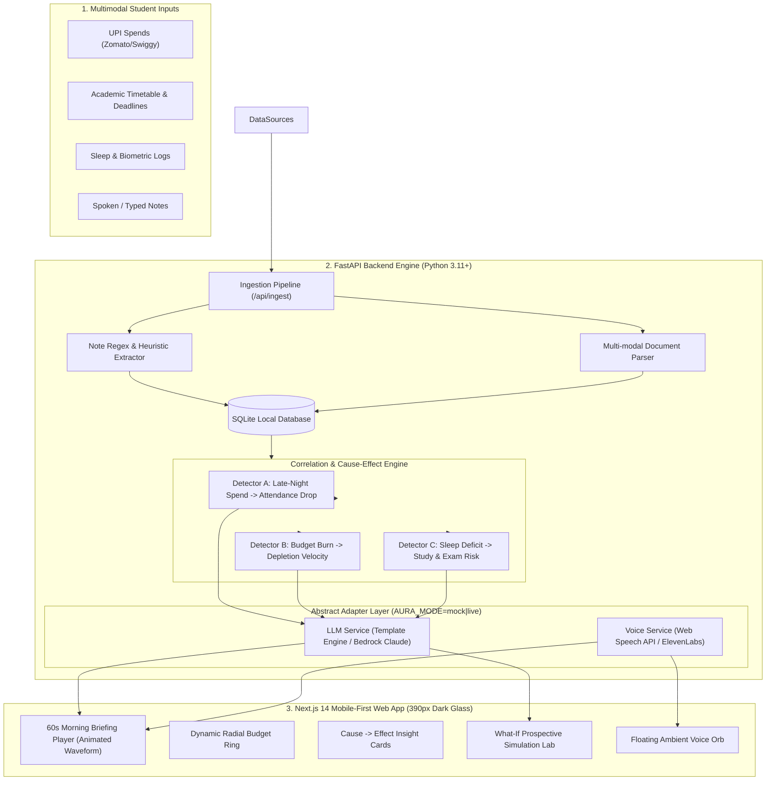

# AURA: Your Voice-First Personal Data Twin
> **Hackathon Track 3: Know Thyself**  
> *A proactive, predictive personal intelligence twin for college students. Multi-variable correlation across finances, circadian sleep, attendance, and exam deadlines.*

---

## 🌟 The Core Concept & USP

Most AI student tools are **passive "chat with your PDF" wrappers**—they only speak when spoken to and treat each domain in isolation.

**AURA** is different:
- **Proactive & Predictive:** AURA continuously watches time-series data across scattered student silos (UPI spends, sleep logs, class timetable, study sessions, and exam deadlines).
- **Finds Non-Obvious Cause-and-Effect Loops:** It doesn't just tell you that you're low on money; it proves that **₹1,840 in midnight Zomato orders delayed your sleep to 2:45 AM**, directly causing you to **miss 5 mandatory 8:30 AM lectures** and fall behind on your **Operating Systems Mid-Term prep**.
- **Voice-First Interaction:** Delivers an autonomous **60-second morning briefing** every day and answers prospective **"What-If"** questions with transparent reasoning chains.
- **100% Local & Sovereign:** Runs locally with **zero API keys required**, storing data in local SQLite with one-click data erasure.

---

## 🏛️ System Architecture



---

## 📁 Repository Structure

```text
twin/
├── README.md                      # Comprehensive guide, architecture & demo script
├── .env.example                   # Environment variable template
├── run.bat                        # Windows 1-click startup script (concurrent servers)
├── run.sh                         # Linux/macOS bash startup script
├── Makefile                       # Developer shortcuts (make dev, make test, make seed)
├── backend/
│   ├── requirements.txt           # Python dependencies
│   ├── app/
│   │   ├── main.py                # FastAPI app with CORS, health check, lifespan seed
│   │   ├── config.py              # Settings configuration (Pydantic v2 Settings)
│   │   ├── models.py              # SQLModel table definitions (LifeEvent, UserProfile)
│   │   ├── schemas.py             # Pydantic v2 request/response schemas
│   │   ├── db.py                  # SQLite engine & session generator
│   │   ├── seed.py                # 30-day realistic student dataset seeder (Arjun)
│   │   ├── routers/
│   │   │   ├── ingest.py          # POST /api/ingest/file, /text, /voice
│   │   │   ├── events.py          # GET /api/events, POST /api/events
│   │   │   ├── insights.py        # GET /api/insights, GET /api/insights/budget
│   │   │   ├── briefing.py        # GET /api/briefing
│   │   │   ├── whatif.py          # POST /api/whatif
│   │   │   ├── voice.py           # POST /api/voice/synthesize
│   │   │   └── privacy.py         # DELETE /api/privacy/wipe, POST /api/privacy/seed
│   │   ├── services/
│   │   │   ├── briefing.py        # 60s briefing generation logic
│   │   │   ├── whatif.py          # Multi-variable prospective reasoning
│   │   │   ├── ingestion/
│   │   │   │   ├── mock_extractor.py # Document OCR/visual extraction
│   │   │   │   └── note_parser.py    # Regex & heuristic text note parser
│   │   │   ├── correlation/
│   │   │   │   ├── engine.py         # Multi-detector orchestrator
│   │   │   │   └── detectors/
│   │   │   │       ├── late_night_spend.py  # Detector A (Late spend -> Missed class)
│   │   │   │       ├── budget_burn.py       # Detector B (Depletion projection)
│   │   │   │       └── sleep_attendance.py  # Detector C (Sleep deficit -> Exam risk)
│   │   │   ├── llm/
│   │   │   │   ├── base.py           # Abstract Base Class for LLM
│   │   │   │   ├── template_llm.py   # High-fidelity mock template LLM
│   │   │   │   └── bedrock_llm.py    # AWS Bedrock Claude adapter stub
│   │   │   └── voice/
│   │   │       ├── base.py           # Abstract Base Class for Voice
│   │   │       ├── mock.py           # Client-side Web Speech fallback
│   │   │       └── elevenlabs.py     # Live ElevenLabs TTS adapter
│   │   └── fixtures/
│   │       └── demo_events.json      # 64 realistic 30-day student events
│   └── tests/
│       ├── test_detectors.py         # Detector pure-function unit tests
│       ├── test_whatif.py            # What-If reasoning engine tests
│       └── test_api_endpoints.py     # FastAPI TestClient endpoint integration tests
└── frontend/
    ├── package.json
    ├── tsconfig.json
    ├── tailwind.config.js
    ├── next.config.mjs
    └── src/
        ├── app/
        │   ├── layout.tsx            # Root mobile container (390px, dark theme)
        │   ├── globals.css           # Tailwind + glassmorphism + waveform styling
        │   ├── page.tsx              # Home dashboard (Briefing, Budget Ring, Top Insights)
        │   ├── upload/page.tsx       # Document upload dropzone & note ingestion
        │   ├── timeline/page.tsx     # Unified 30-day multi-variable timeline feed
        │   ├── insights/page.tsx     # Cross-domain cause-and-effect deep dive
        │   └── whatif/page.tsx       # Prospective What-If simulation laboratory
        ├── components/
        │   ├── Navbar.tsx            # Header with persona & privacy badge
        │   ├── BottomNav.tsx         # Mobile tab bar with active glow
        │   ├── BriefingPlayer.tsx    # Big briefing button with animated audio waveform
        │   ├── BudgetRing.tsx        # Radial SVG budget ring with burn rate warning
        │   ├── VoiceOrb.tsx          # Floating pulsing microphone orb for voice query
        │   ├── UploadDropzone.tsx    # File drag-and-drop & instant note extractor
        │   ├── TimelineFeed.tsx      # Unified feed with event filters & status chips
        │   ├── InsightCard.tsx       # Cause -> Effect chain with evidence events
        │   ├── WhatIfPanel.tsx       # Risk gauge (0-100) & transparent reasoning
        │   └── PrivacyBadge.tsx      # Local privacy modal with 1-click data wipe
        ├── hooks/
        │   ├── useAudioPlayer.ts     # SpeechSynthesis Web Speech TTS controller
        │   └── useVoice.ts           # SpeechRecognition Web Speech STT controller
        └── lib/
            ├── api.ts                # Type-safe API client for backend
            └── types.ts              # Shared TypeScript interfaces
```

---

## ⚡ Quickstart: Run Everything Locally in 60 Seconds

> **Zero API Keys Required.** Everything runs out-of-the-box in `mock` mode with browser Web Speech API.

### Option A: 1-Click Startup (Windows)
Double-click `run.bat` or run:
```cmd
run.bat
```

### Option B: 1-Click Startup (Linux / macOS)
```bash
chmod +x run.sh
./run.sh
```

### Option C: Manual Setup

1. **Start Backend (FastAPI):**
```bash
cd backend
python -m venv venv
# On Windows:
venv\Scripts\pip install -r requirements.txt
venv\Scripts\python -m uvicorn app.main:app --host 0.0.0.0 --port 8000 --reload
# On Linux/macOS:
source venv/bin/activate
pip install -r requirements.txt
python -m uvicorn app.main:app --host 0.0.0.0 --port 8000 --reload
```

2. **Start Frontend (Next.js 14):**
```bash
cd frontend
npm install
npm run dev
```

3. **Open in Browser:**
- **Frontend Dashboard:** [http://localhost:3000](http://localhost:3000) (Mobile view at 390px recommended!)
- **Backend Swagger API Docs:** [http://localhost:8000/docs](http://localhost:8000/docs)

---

## 🧪 Testing & Verification

Run the full backend test suite (unit + integration):
```bash
cd backend
# Windows:
$env:PYTHONPATH="."; venv\Scripts\python -m pytest -v
# Linux/macOS:
PYTHONPATH=. venv/bin/pytest -v
```
**Test Results:**
- `test_detectors.py`: Verifies pure-function detectors for late-night spend chain, budget burn projection, and sleep deficit.
- `test_whatif.py`: Verifies transparent reasoning and risk score calculations for multiple student scenarios.
- `test_api_endpoints.py`: Tests all 9 HTTP endpoints (health, events, insights, budget, briefing, whatif, file ingestion, text ingestion, privacy wipe & re-seed).

---

## 🎭 What's Mocked vs. Live

AURA uses an **Abstract Base Class Adapter Pattern** controlled via the environment variable `AURA_MODE=mock|live` (default: `mock`):

| Component | In Mock Mode (`AURA_MODE=mock`) | In Live Mode (`AURA_MODE=live`) |
| :--- | :--- | :--- |
| **LLM Reasoning & Script** | `TemplateLLMService`: Pure-code template engine that parses intent with regex/keywords, evaluates actual student events from SQLite, and produces transparent reasoning chains. | `BedrockLLMService`: Connects to AWS Bedrock Anthropic Claude using `AWS_ACCESS_KEY_ID` and `AWS_SECRET_ACCESS_KEY`. |
| **Speech Output (TTS)** | **Browser Web Speech API (`SpeechSynthesis`)**: Zero latency, 100% free, runs client-side in Google Chrome / Edge / Safari without downloading audio files. | `ElevenLabsVoiceService`: Calls ElevenLabs API if `ELEVENLABS_API_KEY` is provided to generate studio-quality MP3 audio. |
| **Speech Input (STT)** | **Browser Web Speech API (`SpeechRecognition`)**: Native on-device speech-to-text with Indian English (`en-IN`) acoustic models. | Whisper / Cloud STT via backend. |
| **Document Ingestion** | `mock_extractor.py`: Inspects uploaded document name and content type, simulating realistic OCR extraction with confidence scores (e.g. UPI transaction ID, merchant, timestamp). | Amazon Textract / Claude 3.5 Sonnet Vision OCR. |
| **Natural Language Notes** | `note_parser.py`: Fast regex & heuristic extractor mapping phrases like `"Spent 120 on snacks after late lab"` to typed `LifeEvent` objects with category tagging. | LLM Function Calling / Structured Outputs. |

---

## 🎬 3-Minute Hackathon Demo Script (Judges Walkthrough)

Follow this exact sequence for a high-impact demo:

### ⏱️ Minute 0:00 - 0:45: The Hook & The Persona
1. Open [http://localhost:3000](http://localhost:3000) on mobile viewport (390px).
2. Point out the student persona: **Arjun**, 2nd-year CSE at RVCE Bengaluru, monthly allowance ₹6,000.
3. Tap **"Play 60s Morning Briefing"**:
   - The animated waveform lights up.
   - The browser speaks the briefing aloud in natural voice:
     > *"Good morning Arjun. Here is your 60-second data twin briefing... You have spent ₹4,769 of your ₹6,000 allowance. At this velocity, your funds will deplete on the 24th—6 days early... You have ₹1,840 in midnight food deliveries, and five of those nights led directly to missed 8:30 AM lectures... OS Mid-term is in 6 days."*
4. Show the **highlights card** summarizing the 3 key takeaways.

### ⏱️ Minute 0:45 - 1:30: Cause-and-Effect Correlation
1. Scroll down to the **Monthly Budget Twin** radial ring:
   - Notice ₹4,769 / ₹6,000 spent (79%).
   - Notice daily burn ₹207/day vs safe ₹200/day.
   - See the early warning: *"Projected run out on the 24th, 6 days early. Cap today to ₹120."*
2. Tap the **Insights** tab:
   - Walk through the **Late-Night Deliveries Driving Morning Attendance Drops** card:
     - Show the **Root Cause** (₹1,840 spent across 7 food orders past 11 PM) ➔ **Downstream Effect** (5 missed 8:30 AM lectures).
     - Expand **"View Evidence"** to show actual correlated database records.
   - Walk through the **Sleep Deficit Compounding OS Mid-Term Academic Risk** card:
     - 4.8h sleep before early lectures linked to 63% study block abandon rate with the OS Mid-term exam just 6 days away.

### ⏱️ Minute 1:30 - 2:15: The Prospective "What-If" Simulator
1. Tap the **What-If** tab in bottom navigation.
2. Tap the quick scenario chip: **"What if I order Zomato tonight?"** (or tap the microphone orb and speak it!).
3. Observe the immediate multi-variable calculation:
   - **Risk Score: 84/100 (High Risk)**.
   - **Predicted Consequences:**
     - Financial: Drains another ₹280, pulling budget depletion forward by 18 hours.
     - Circadian: Past logs predict 2:45 AM sleep onset.
     - Academic: **71% historical probability of missing tomorrow's 8:30 AM lecture.**
   - Listen to AURA speak the warning and recommendation.
   - Expand the **Transparent Reasoning Chain** to prove this is calculated from actual SQLite data, not a hallucination!
4. Try another scenario: **"What if I go to bed at 10:30 PM?"** ➔ **Risk Score drops to 8/100 (Low Risk / Recommended)**.

### ⏱️ Minute 2:15 - 3:00: Multimodal Ingestion & Data Sovereignty
1. Tap the **Upload** tab:
   - Upload any sample receipt/image, or type a natural language note:
     > `"Spent 120 on snacks after late lab"`
   - Hit **Ingest**: Watch it instantly parse into an `Expense` chip with category `Food`, amount `₹120`, and `96% confidence`.
2. Tap the **Local & Private** badge in the navbar:
   - Show the Data Sovereignty modal.
   - Tap **"Delete All My Data"** ➔ Verify that all personal logs are instantly erased from SQLite.
   - Tap **"Reset 30-Day Demo Data"** ➔ Instantly restores Arjun's 64 events for the next evaluator!

---

## 🔒 Privacy & Data Sovereignty

- **Zero Cloud Storage:** All UPI details, attendance records, and sleep logs reside exclusively on the user's device in SQLite (`backend/aura.db`).
- **No Third-Party Telemetry:** Speech recognition and speech synthesis execute via the client-side W3C Web Speech API inside the browser.
- **One-Click Erase:** Full compliance with the "Right to be Forgotten" via `DELETE /api/privacy/wipe`.

---

## 🏆 Hackathon Alignment (Track 3: Know Thyself)

AURA directly addresses the core hackathon themes:
1. **Self-Understanding:** Connects disparate biological, financial, and academic indicators that students typically view in silos.
2. **Proactive Intervention:** Surfaces predictive warnings *days in advance* before attendance breaches or bank overdrafts occur.
3. **Voice-First Accessibility:** Hands-free 60-second morning briefing designed for sleepy college mornings.
